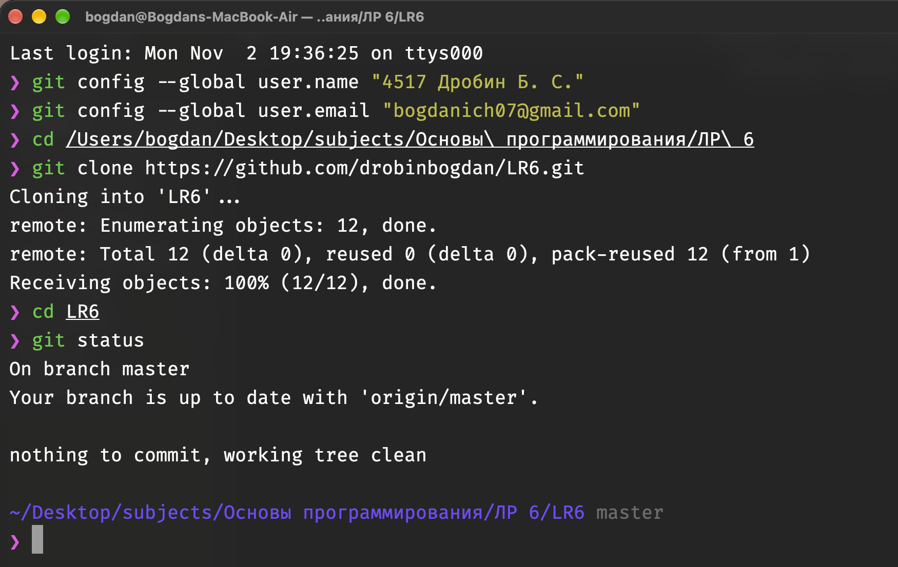
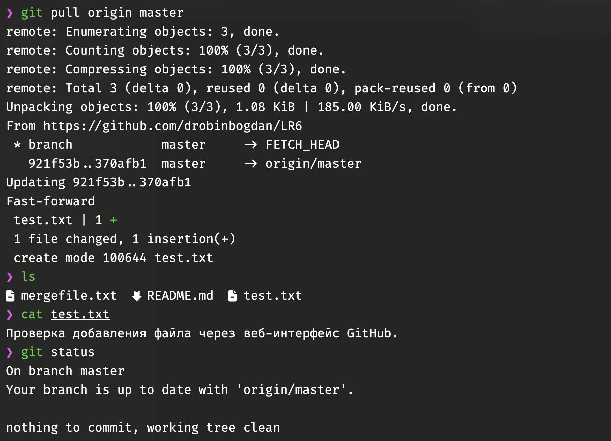
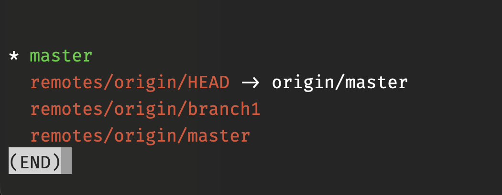
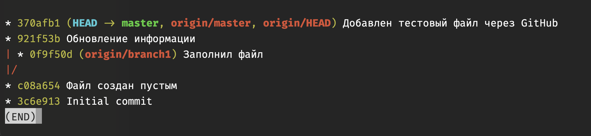
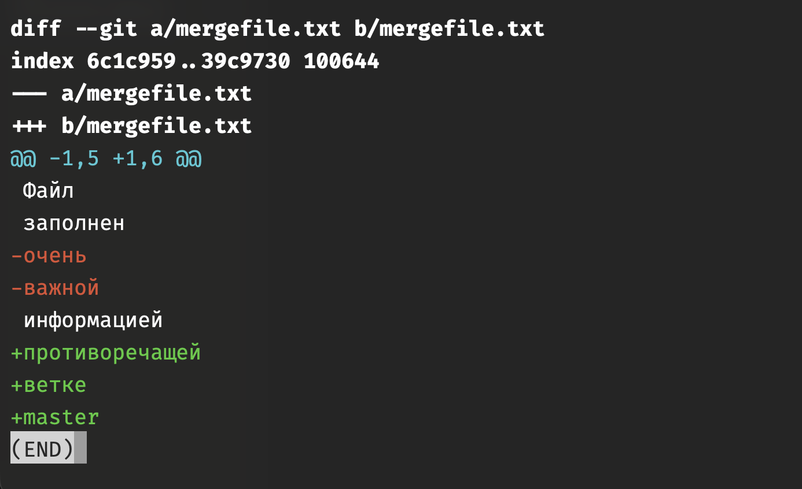
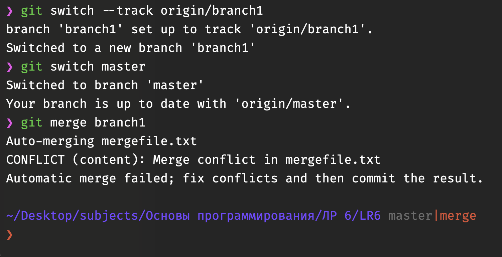
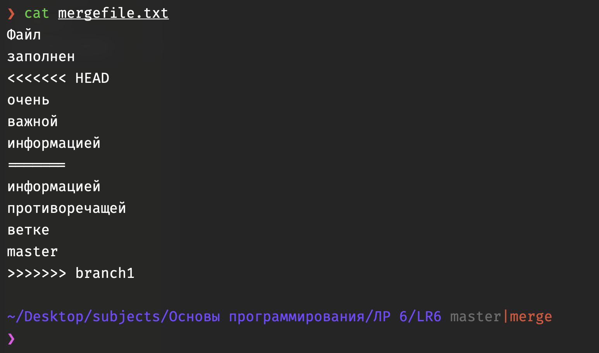
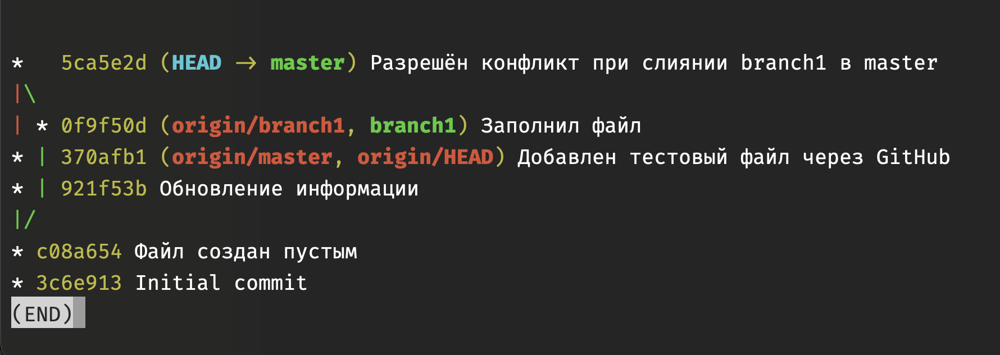
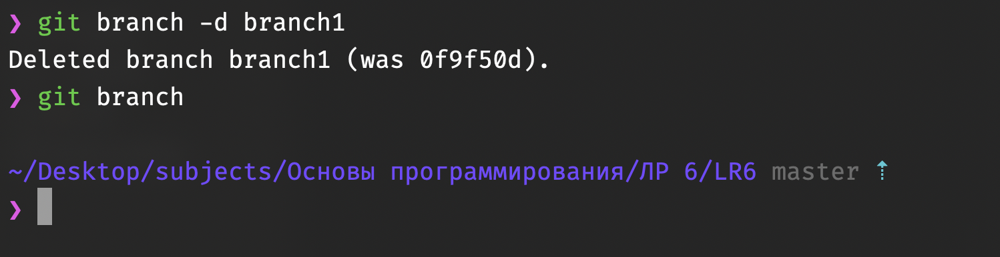
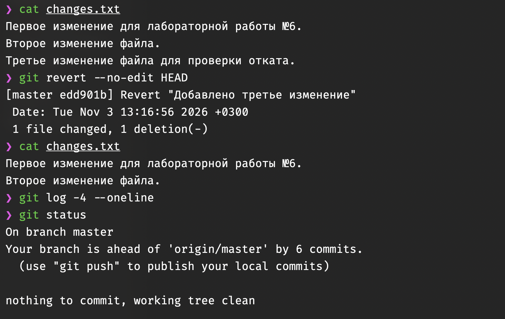

# Лабораторная работа №6. Система контроля версий

## 1. Цель работы

Изучение базовых возможностей системы управления версиями, опыт работы с Git Api, опыт работы с локальным и удаленным репозиторием.

## 2. Постановка задачи

В ходе лабораторной работы необходимо создать личную копию удалённого репозитория GitHub, настроить локальный клиент Git, выполнить клонирование репозитория и синхронизацию изменений.

Также необходимо изучить историю коммитов и работу с ветками, выполнить слияние с разрешением конфликта, удалить побочную ветку, создать несколько коммитов и выполнить откат одного из них.

Результаты выполнения работы требуется оформить в файле `README.md` с использованием языка разметки Markdown.

## 3. Выполнение лабораторной работы

### 3.1. Настройка Git и клонирование репозитория

Учётная запись на платформе GitHub была создана ранее. Система контроля версий Git также уже была установлена на компьютере. С помощью команды git --version была проверена её работоспособность и определена установленная версия — 2.54.0 (Apple Git-157).

На платформе GitHub был создан Fork репозитория преподавателя [Kurtyanik/LR6](https://github.com/Kurtyanik/LR6).

Затем был настроен локальный клиент Git: указаны имя пользователя в формате «Группа Фамилия И.О.» и адрес электронной почты.

Репозиторий был клонирован на компьютер с помощью команды `git clone`. Команда `git status` подтвердила, что активна ветка `master`, синхронизированная с `origin/master`, а рабочая директория не содержит незакоммиченных изменений.



*Рисунок 1 — Настройка Git и клонирование удалённого репозитория*

### 3.2. Получение изменений из удалённого репозитория

Через веб-интерфейс GitHub в ветке `master` был создан файл `test.txt` с тестовым содержимым.

После фиксации изменений на GitHub была выполнена команда `git pull origin master`, которая загрузила изменения в локальный репозиторий.

Команда `ls` подтвердила наличие нового файла, а `cat test.txt` позволила проверить его содержимое. Состояние репозитория было проверено с помощью `git status`.



*Рисунок 2 — Получение изменений из удалённого репозитория*

### 3.3. Просмотр веток и истории коммитов

Для просмотра локальных и удалённых веток использовалась команда `git branch -a`.

В репозитории были обнаружены основная ветка `master` и побочная ветка `origin/branch1`.



*Рисунок 3 — Просмотр локальных и удалённых веток*

С помощью команды `git log --all --oneline --graph --decorate` была изучена история коммитов всех веток.

Установлено, что ветки `master` и `branch1` имеют общую историю, но содержат различные изменения.



*Рисунок 4 — Граф истории коммитов репозитория*

### 3.4. Просмотр изменений

Для сравнения содержимого файла `mergefile.txt` между ветками использовалась команда `git diff`.

В результате были обнаружены различия между изменениями основной и побочной веток.

Строки, помеченные знаком `-`, соответствуют содержимому первой сравниваемой версии, а знаком `+` — второй.



*Рисунок 5 — Сравнение содержимого файла mergefile.txt между ветками*

### 3.5. Слияние веток и разрешение конфликта

Для выполнения слияния была создана локальная ветка `branch1`, отслеживающая `origin/branch1`.

После переключения на `master` была выполнена команда `git merge branch1`.

В процессе слияния возник конфликт содержимого файла `mergefile.txt`, поскольку обе ветки изменили один и тот же участок.



*Рисунок 6 — Обнаружение конфликта при слиянии веток*

Для разрешения конфликта было изучено содержимое файла `mergefile.txt` с помощью команды `cat mergefile.txt`.

Git обозначил несовместимые изменения специальными маркерами `<<<<<<< HEAD`, `=======` и `>>>>>>> branch1`.



*Рисунок 7 — Содержимое файла mergefile.txt с маркерами конфликта*

Конфликт был разрешён вручную: содержимое файла отредактировано, изменения обеих веток объединены, а служебные маркеры удалены.

После проверки изменений с помощью `git diff --check` исправленный файл был добавлен в индекс командой `git add mergefile.txt`.

Слияние завершилось созданием коммита `5ca5e2d` с комментарием «Разрешён конфликт при слиянии branch1 в master».



*Рисунок 8 — История коммитов после успешного слияния веток*

### 3.6. Удаление побочной ветки

После успешного слияния локальная ветка `branch1` была удалена командой `git branch -d branch1`.

Проверка командой `git branch` подтвердила, что активной локальной веткой осталась `master`.



*Рисунок 9 — Удаление побочной ветки после слияния*

### 3.7. Создание коммитов и откат изменений

Для изучения фиксации изменений был создан файл `changes.txt`.

В файл последовательно добавлялись новые строки, после чего изменения фиксировались отдельными коммитами с комментариями.

В результате были созданы три коммита:

- `32f0214` — «Добавлен файл с первым изменением».
- `bbca6aa` — «Добавлено второе изменение».
- `852c211` — «Добавлено третье изменение».

Для отмены последнего изменения использовалась команда `git revert --no-edit HEAD`.

В результате был создан новый коммит `edd901b`, отменяющий третье изменение файла.

После отката в файле `changes.txt` остались первые две строки. При этом исходный коммит сохранился в истории, что демонстрирует принцип работы команды `git revert`.



*Рисунок 10 — Выполнение отката коммита и проверка результата*

### 3.8. Создание ветки и оформление отчёта

Для оформления отчёта была создана отдельная ветка `report` с помощью команды `git switch -c report`.

В репозитории была создана папка `screenshots`, в которую помещены десять снимков экрана, иллюстрирующих выполнение лабораторной работы.

Для исключения служебных файлов macOS из отслеживания системой Git был создан файл `.gitignore`, содержащий запись `.DS_Store`.

После добавления изображений и файла `.gitignore` был создан коммит `8b0566a` с комментарием «Добавлены скриншоты и настроено исключение служебных файлов».

Далее в редакторе Visual Studio Code был подготовлен отчёт в файле `README.md` с использованием языка разметки Markdown. В документ были добавлены описание выполненных операций, скриншоты и подписи к ним.

Изменения были зафиксированы коммитом `0d217ce` с комментарием «Добавлено описание выполнения лабораторной работы».

## 4. Лог использованных команд

Ниже приведён лог основных команд, использованных при выполнении лабораторной работы, без результатов их выполнения.

```bash
git --version
git config --global user.name "4517 Дробин Б. С."
git config --global user.email "bogdanich07@gmail.com"

git clone https://github.com/drobinbogdan/LR6.git
cd LR6
git status

git pull origin master
ls
cat test.txt
git status

git branch -a
git log --all --oneline --graph --decorate
git log origin/branch1 --oneline
git log -p -1 origin/branch1
git diff master origin/branch1 -- mergefile.txt

git status
git switch --track origin/branch1
git switch master
git merge branch1

cat mergefile.txt
open -e mergefile.txt
git diff --check
git add mergefile.txt
git status
git commit -m "Разрешён конфликт при слиянии branch1 в master"

git log --oneline --graph --all --decorate
git branch -d branch1
git branch
git status

echo "Первое изменение для лабораторной работы №6." > changes.txt
cat changes.txt
git status
git add changes.txt
git commit -m "Добавлен файл с первым изменением"

echo "Второе изменение файла." >> changes.txt
git add changes.txt
git commit -m "Добавлено второе изменение"

echo "Третье изменение файла для проверки отката." >> changes.txt
git add changes.txt
git commit -m "Добавлено третье изменение"

git log -3 --oneline
cat changes.txt
git revert --no-edit HEAD
cat changes.txt
git log -4 --oneline
git status

git switch -c report
git branch
git status
mkdir screenshots
open screenshots
ls -1 screenshots
git status

echo ".DS_Store" >> .gitignore
git status
git add screenshots/ .gitignore
git commit -m "Добавлены скриншоты и настроено исключение служебных файлов"

git status
git log -1 --oneline
code README.md
git status
git diff --check
git add README.md
git commit -m "Добавлено описание выполнения лабораторной работы"

git log -2 --oneline
git status
```
